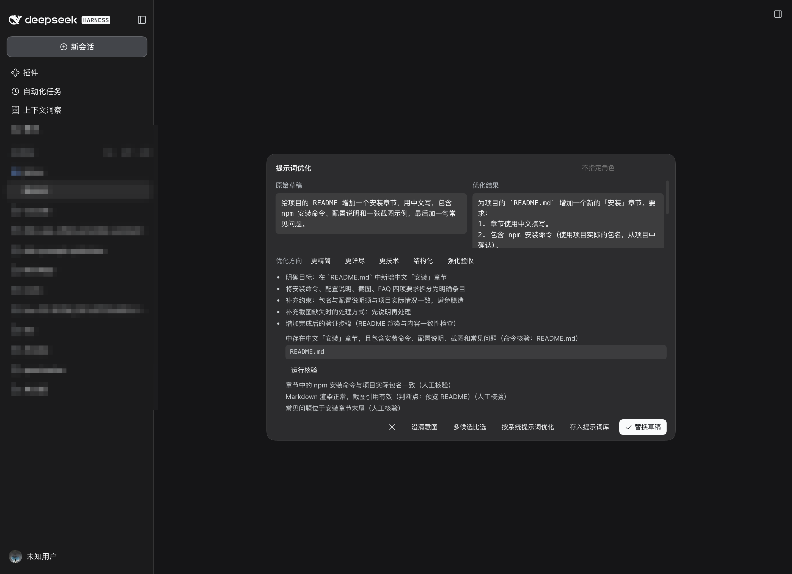
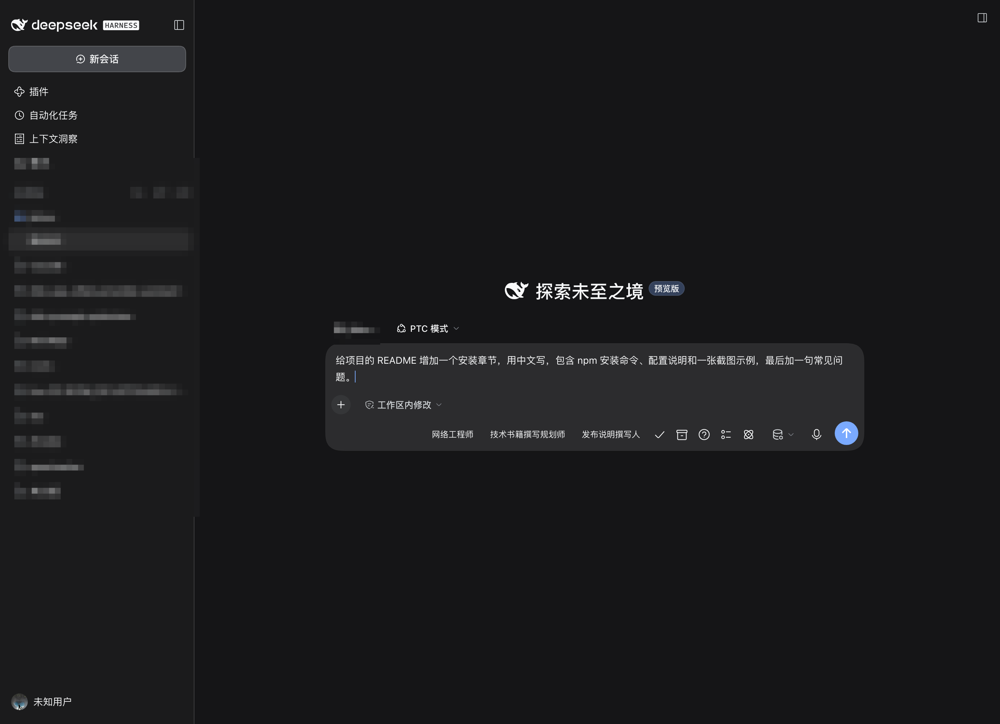
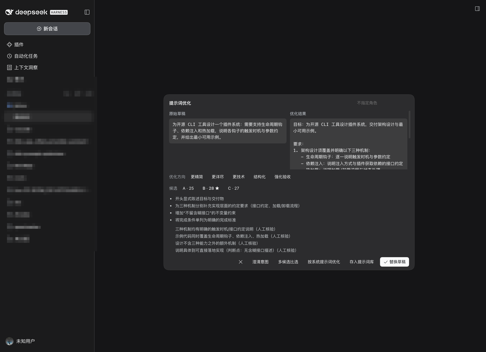
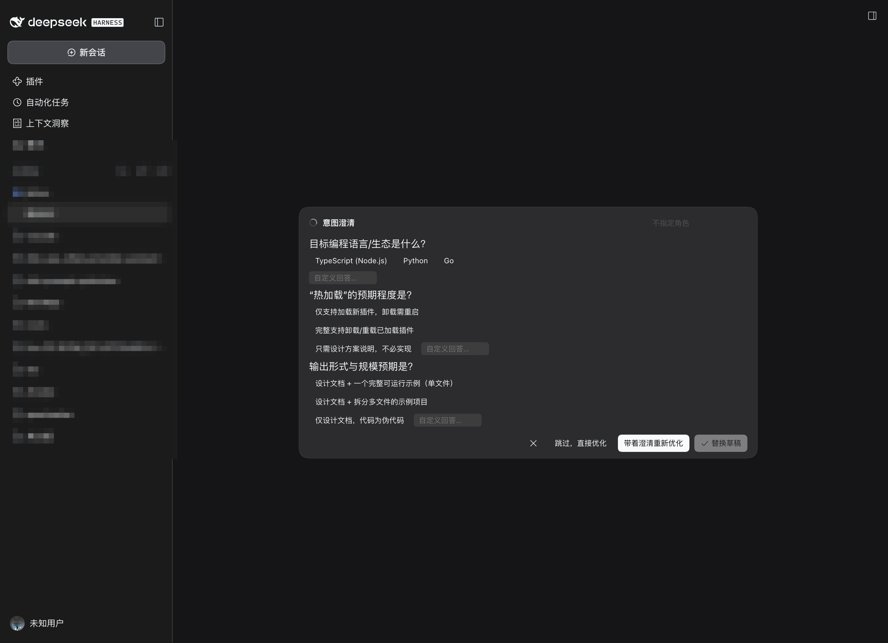
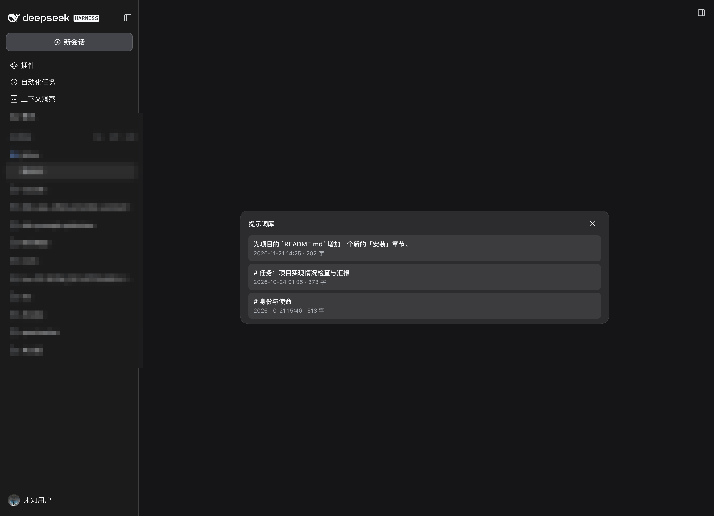
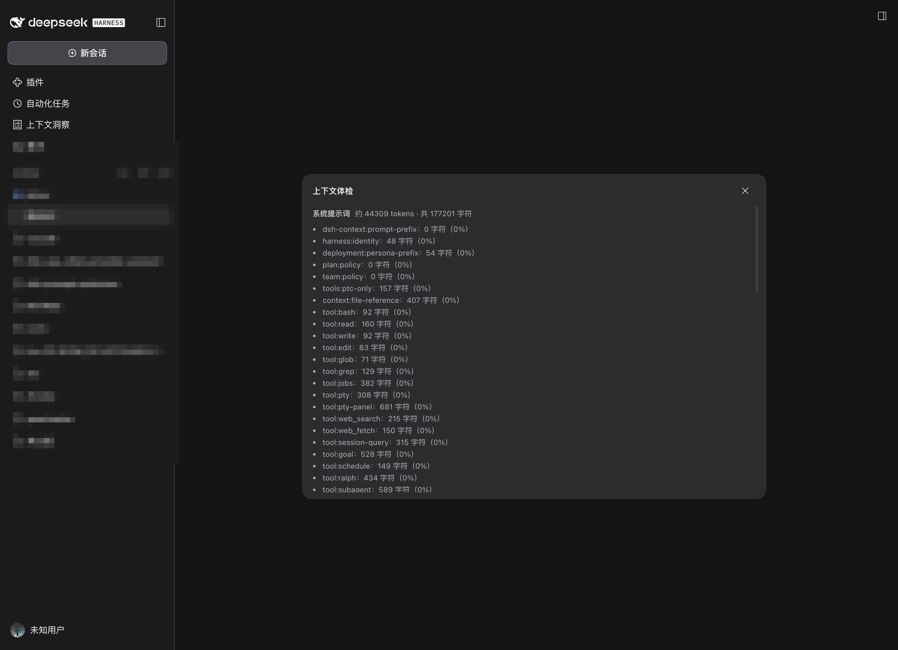
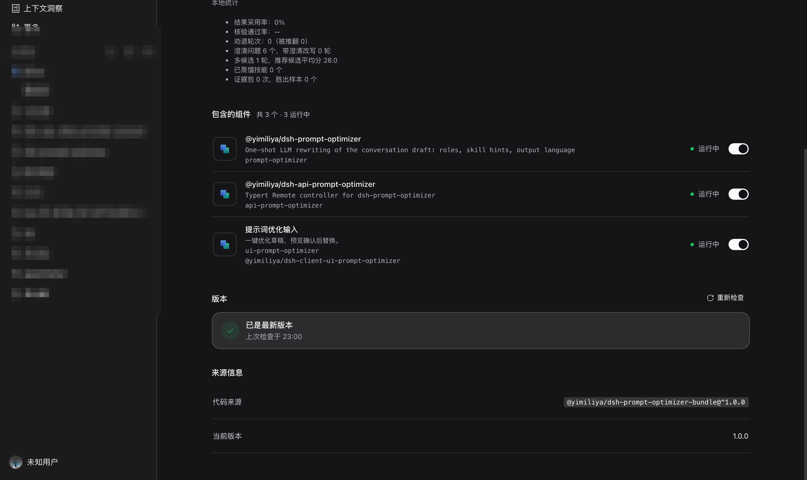

# dsh-prompt-optimizer

[English](README.md) · [简体中文](README_zh.md)

[](https://github.com/ViewWay/dsh-prompt-optimizer/actions/workflows/ci.yml)
[](https://www.npmjs.com/package/@yimiliya/dsh-prompt-optimizer-bundle)
[](https://github.com/ViewWay/dsh-prompt-optimizer)
[](https://dshfind.com/en/plugins/ViewWay/dsh-prompt-optimizer?ref=badge)

**The DeepSeek Harness plugin that turns a rough idea draft into an agent-ready prompt** — iterative **rewrite → self-review → fix** rounds, with every intermediate artifact exposed for review instead of hidden.

A standalone, independently distributed plugin family. One install adds five entry points on the input row and a preview panel that makes optimization auditable:

| Entry | What it does |
| --- | --- |
| **Optimize** | One click on the input box rewrites the draft; domain recommendation chips suggest a fitting role first |
| **Intent interview** (`?`) | Up to three domain-conditioned clarifying questions with clickable candidates, answered *before* the rewrite |
| **Acceptance-first** | Mechanical acceptance criteria ship with an executable check-command template |
| **Multi-candidate** | 2–4 differentiated rewrites scored by one judge round, Pareto marks and a recommended pick |
| **Context checkup** | A deterministic, zero-LLM scan of the session's standing system prompt and invocable skills — with one-click repairs for fixable findings |
| **Prompt library** | Save any result, then browse, insert, re-optimize or delete it from the input row |



Every round is reviewable, not a black box — the preview panel puts the draft and the result side by side with the change log, acceptance criteria, and matched skills:

| Panel block | What it is | How to judge with it |
| --- | --- | --- |
| Optimized text | The rewritten prompt | Read it against the draft column, section by section |
| Changes | Each edit the model says it made | Ask per bullet: did it make the task clearer? Was anything changed that should not have been? |
| Acceptance criteria | Conditions that define done | Mechanical ones run via the check button; the rest verify by their stated judgment point — none verifiable means suspicious |
| Skills | Installed skills matched this round | Skill mentions must use exact listed names; with none listed, the result must not invent any |
| Critique | Revision log of the system-prompt second round | Does each revision say what changed and why? |

Quick checklist: **zero detail loss** (paths, versions, commands, numbers verbatim) · **clear structure** (goal, context, constraints, expected output stated separately) · **no inventions** · **verifiable acceptance** · **sound skill references**. When a check fails: hit **Regenerate** (the rejected result rides in as a prior attempt), click a direction chip (more concise / more detailed / more technical / restructure / stronger acceptance), re-run with another role, or switch to system-prompt mode.

## Install / update

### In the DeepSeek Harness web or desktop client

Search `@yimiliya/dsh-prompt-optimizer-bundle` in the **Add plugin** wizard, then click **Install**. The bundle stacks `prompt-optimizer`, `api-prompt-optimizer` and `ui-prompt-optimizer` into the profile in one shot.

### With the `dsh` CLI

```sh
dsh plugin --profile web add @yimiliya/dsh-prompt-optimizer-bundle
```

or update:

```sh
dsh plugin --profile web update @yimiliya/dsh-prompt-optimizer-bundle@latest
```

Then start the web UI with `dsh web`. No build, no restart needed.

Before all four packages exist on npm, install from tarballs — a raw local path or git spec does **not** work, because the bundle's `workspace:*` dependencies resolve only inside this repository's pnpm workspace while `dsh plugin add` installs inside the profile's own root. Packing rewrites those ranges to real versions, so this path needs the other three packages published first:

```sh
pnpm -r pack        # writes *.tgz next to each package.json
dsh plugin --profile web add packages/bundle/yimiliya-dsh-prompt-optimizer-bundle-<version>.tgz
```

## What you get

### Role library — 164 roles, recommended before every rewrite

`<slug>.md` files ship inside the package and are used whenever `rolesDir` is unset: list roles on demand, recommend by draft, re-run with an explicit role, and set a default role in the settings page. **Output language follows the agent UI language** — a Chinese interface yields Chinese prompts, English yields English, while code identifiers, paths and commands stay verbatim.

### Skill awareness — matched installed skills folded into the rewrite

When a draft matches an installed skill, its name and description are folded into the meta-prompt so the output references those skills — guarded by exact-name constraints against hallucination. Chinese and English drafts both match: a built-in bilingual gloss bridges terms like 页面／接口／部署 to English-described skills and back.

### Model-tier awareness + decline-to-optimize

The rewrite conditions on the resolved route's capability tier: reasoning models get scaffolding-free, specification-dense rewrites; small local models behind LiteLLM/vLLM/Ollama get every invariant spelled out. And `skipCheck` keeps the tool honest — a short, clear, generic draft on a reasoning model is **declined with an explanation** instead of rewritten; any explicit rerun still dispatches.

### Multi-candidate comparison — one trigger, differentiated rewrites, one judge



One trigger generates 2–4 differentiated candidate rewrites — every later candidate sees its siblings and must make different trade-offs — then one judge round scores each on faithfulness, completeness, and clarity (0–10). The panel shows labeled candidates with totals, Pareto-optimal marks, and the judge's recommended pick; picking a candidate swaps it into the normal apply/library/evolution flows. A failed judge degrades to unscored candidates instead of failing the round.

### Intent interview — clarify first, rewrite once



A `?` trigger on the input row asks up to three domain-conditioned clarifying questions with clickable candidates before rewriting. The answers ride into the round as authoritative requirements and survive every rerun — "nothing worth asking" falls straight through to the plain round.

### Prompt library — recurring prompts become assets



Save any result with one click; the library button on the input row opens a management panel — browse, expand, insert into the draft, re-optimize from a stored entry, or delete with a two-step confirm (newest first).

### Context checkup — a deterministic audit of standing context



One deterministic, no-LLM scan of the session's standing context: the assembled system prompt's sections (per-section sizing, share of the whole, rough token estimate) plus every model-invocable skill the registry lists for the working directory (deep-read bodies, duplicate detection, stale file-reference checks against each skill's directory). It surfaces oversized blocks, near-duplicate sections or skills, and references to files that no longer exist. Opened from the input row, rendered as a report card with findings.

### Context repair — every fixable finding becomes a one-click fix

Every repairable checkup finding has a repair path: stale file references are stripped deterministically (with a nearest-existing-file suggestion), duplicate skills merge over one model round into the first definition (the retired half becomes a labeled tombstone, both originals kept as `.bak`), and duplicate system-prompt sections get an advisory merged replacement to copy by hand. Every write is preview → confirm → rescan.

### Skill evolution — update the skill instead of duplicating it

Once a draft shape is distilled, the next repeat threshold suggests *updating that skill* instead of distilling a fresh one — one evolution round folds the newer round's requirements into the existing definition and overwrites it in place (`.bak` kept).

### Adoption feedback — later rounds reference their prior art

Every applied result is remembered as a same-domain precedent (best 3 per domain, ranked by judge score then recency) and later rounds in that domain reference it as prior art — reference-only, never copied; local-small routes skip the block; the `precedents` config turns storage off.

### Evidence pack — does optimization actually help on this route?

A bundled, domain-interleaved set of fuzzy sample drafts answers "does optimization actually help on this route?" — one click rewrites and judge-scores each sample raw-vs-optimized inside the context-checkup panel; results land in the local-metrics card, and the model-switch staleness note now points at re-running the comparison.

### Acceptance-first mode — pin the observable definition of done

A dedicated trigger runs the goal interview whose first question always pins the observable definition of done; the answer compiles into authoritative `goalCriteria` the rewrite must satisfy and restate, while further answers stay ordinary clarifications.

### Skill distillation — the third rewrite of the same draft becomes a skill

The host fingerprints every completed round (a one-way normalized-draft hash — never content); on the third optimization of the same draft the panel offers to distill it into a durable agent skill. One model round drafts a `SKILL.md` (frontmatter name/description plus a progressive-disclosure body), you review it, and the confirm writes it into the session project's `.dsh/skills` (or a configured `distillDir`), where the harness skill registry picks it up immediately — the recurring prompt becomes a named, invocable asset instead of another rewrite.

### Local metrics + model-switch reminder

Every round's outcome is counted locally — adoption rate, verify pass rate, declines and overrides, interview questions, candidate averages — and rendered on the settings page; rows carry the route and timestamp only, never draft content. Every system-prompt round records the route it was tuned on (per session, local only); when a later round resolves a different model, the preview panel says the standing system prompt was tuned for the old route and suggests re-running the system optimization. Template changes are guarded by a byte-identical golden suite over every meta-prompt, so no rewrite-quality regression ships unnoticed.



## Configuration (optional — `plugins > config > prompt-optimizer` in cordis.yml)

| Field | Default | Description |
| --- | --- | --- |
| `verifyTimeoutMs` | see source | Timeout for acceptance-check commands |
| `domainPriors` | `true` | Inject priors based on the draft's technical domain |
| `provider` / `model` | unset | Explicit model routing for optimization; the two must appear together |
| `rolesDir` | bundled catalog | Role definition directory override (`<slug>.md`); the shipped role library is used when unset and stays read-only for role evolution |
| `defaultRole` | unset | Default role slug when none is specified; also settable in the settings page |
| `skillAware` | `true` | Fold matched installed skills into the meta-prompt |
| `skipCheck` | `true` | Let the decline-to-optimize precheck skip rounds it cannot improve |
| `metrics` | `true` | Record local outcome metrics (adoption, verify, declines, interviews) for the settings card |
| `precedents` | `true` | Remember adopted results as same-domain precedents (stored with content, unlike metrics) that later rounds reference |

## Privacy

Optimization runs are recorded in the session's own event log; treat drafts accordingly:

- Every optimization round appends a `plugin:prompt-optimizer/llm-request` record containing the full draft text and the auxiliary system prompt.
- Every check run appends a `plugin:prompt-optimizer/verify` record containing the executed command and its (redacted) output.
- A declined round appends a `plugin:prompt-optimizer/skipped` record containing the stable skip reason and the draft's byte size.
- Local metrics store one row per outcome (kind, route, tier, timestamp, count) in their own storage domain — never draft or result text. Skill links store a one-way draft fingerprint plus the skill name; repeat fingerprints are one-way hashes too.
- The precedents domain is the one deliberate exception: it stores the full adopted optimized text (best 3 per domain) so later rounds can reference it as prior art — same machine, same session log the draft already lives in, never sent anywhere. Turn `precedents: false` to stop storing and injecting them.
- A confirmed context repair or skill evolution writes `.bak` backups next to every file it rewrites, in the session project's skill directory.
- "Improve this role" rewrites the role definition file `<slug>.md` under the configured `rolesDir` on disk; the previous version is kept alongside it as `<slug>.md.bak`. The bundled default catalog is read-only: configure `rolesDir` to enable role evolution.

If you paste secrets into a draft, expect them to appear in the session log.

## Repository layout

| Package | npm | Purpose |
| --- | --- | --- |
| `packages/prompt-optimizer` | [@yimiliya/dsh-prompt-optimizer](https://www.npmjs.com/package/@yimiliya/dsh-prompt-optimizer) | Host service: optimization rounds, role library, skill hints, model routing |
| `packages/api-prompt-optimizer` | [@yimiliya/dsh-api-prompt-optimizer](https://www.npmjs.com/package/@yimiliya/dsh-api-prompt-optimizer) | Remote controller and Typert descriptors (host/client shared method table) |
| `packages/client-ui-prompt-optimizer` | [@yimiliya/dsh-client-ui-prompt-optimizer](https://www.npmjs.com/package/@yimiliya/dsh-client-ui-prompt-optimizer) | Browser UI: trigger button, preview panel, queue entries, settings page |
| `packages/bundle` | [@yimiliya/dsh-prompt-optimizer-bundle](https://www.npmjs.com/package/@yimiliya/dsh-prompt-optimizer-bundle) | Profile bundle (`cordis.patch.yml`) that installs all three plugins in one shot |

Each package carries its own README, which npm renders on the package page; this document is the family-level view. `tools/tsdown.client.ts` is the standalone client build preset: it emits browser closure artifacts against the harness `window.__ModuleLoader__.load({id, factory})` contract, with CSS Modules compiled by lightningcss into self-contained injected styles.

## Development

```sh
pnpm install
pnpm run check      # lint + typecheck + build + test (the same gate CI runs)
pnpm run typecheck  # TypeScript only
pnpm run lint       # oxlint
pnpm run test       # vitest (node + client projects)
pnpm run build      # tsdown, dependency order
```

- **node project** (host + api tests) runs out of the box.
- **client project** (jsdom browser tests) resolves the `@deepseek-ai/*` modules through a deepseek-harness checkout: the published dsh client packages are browser closure artifacts that only load inside the real web client, so tests follow the harness `tsconfig.base.json` paths map into its source tree — the same way these suites run natively inside the harness repo. It defaults to the sibling checkout `../deepseek-harness-latest`, or point at it explicitly:

  ```sh
  DSH_HARNESS_ROOT=/path/to/deepseek-harness pnpm run test
  ```

  The harness checkout must have had `pnpm install` run inside it (its sources resolve their own dependencies from its tree). The test config also pins react / react-dom / use-sync-external-store to a single copy to avoid cross-copy hook errors.

Agents and contributors should read [AGENTS.md](AGENTS.md) for repo conventions.

## Compatibility

The supported baseline is `@deepseek-ai/dsh-*` `0.2.1-rc.5`; earlier versions are unverified. Installed releases keep working across the whole `0.2.x` line via `engines.dsh` — details, including the queue-entry slot requirement and the pinned peer dependencies, live in [docs/compatibility.md](docs/compatibility.md), which is the single source of truth.

## Releasing (maintainers)

Keep the four packages on one version. Tag a release (`git tag vX.Y.Z && git push origin vX.Y.Z`) and GitHub Actions builds, checks and publishes all four packages to npm in dependency order (host → api → client → bundle). See `.github/workflows/release.yml`.

## Like it?

If `dsh-prompt-optimizer` makes your drafts land better, please star the repo on [GitHub](https://github.com/ViewWay/dsh-prompt-optimizer) — issues and PRs are welcome too!

## License

[Apache-2.0](LICENSE)
