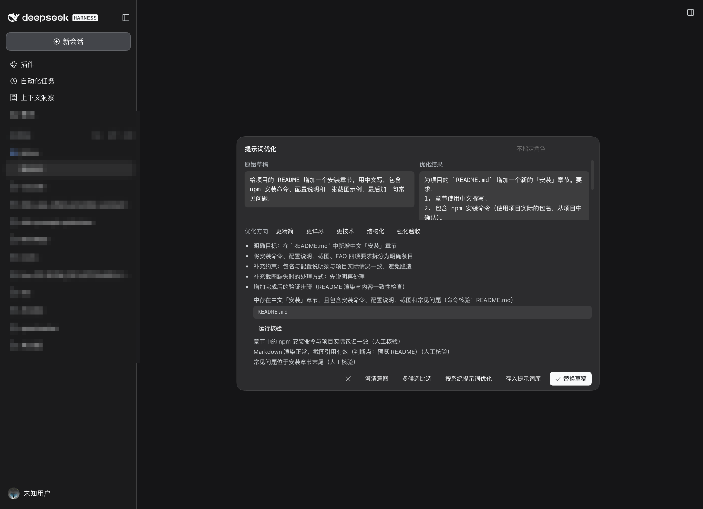
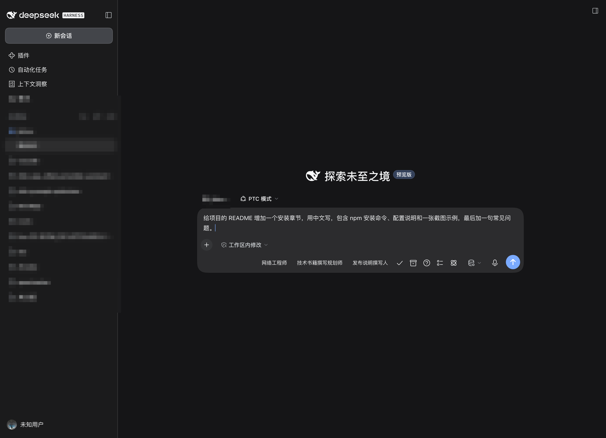
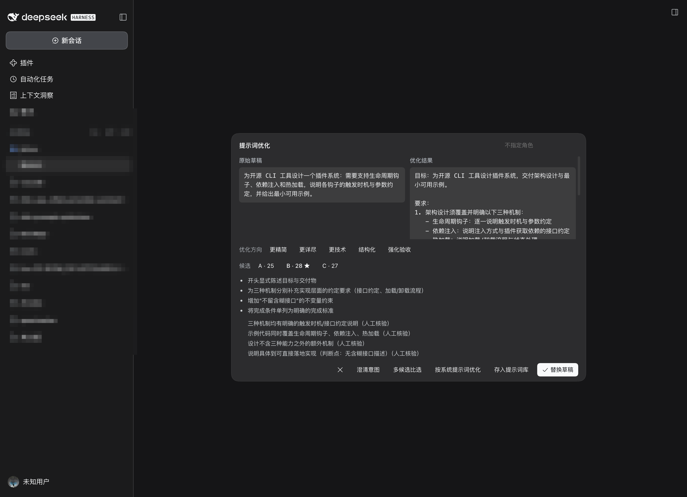
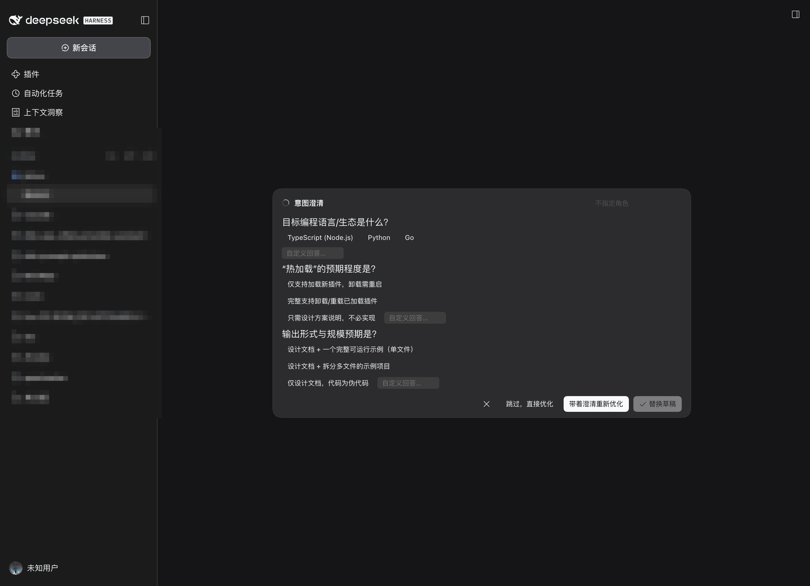
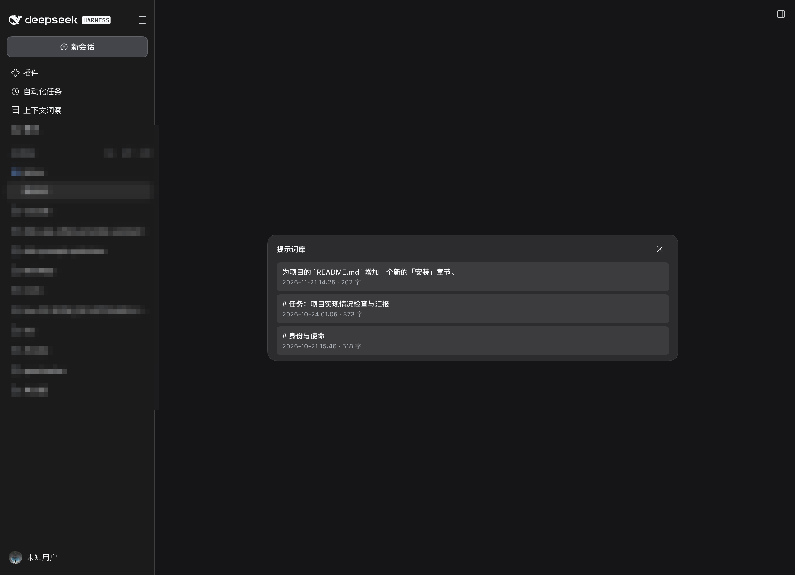
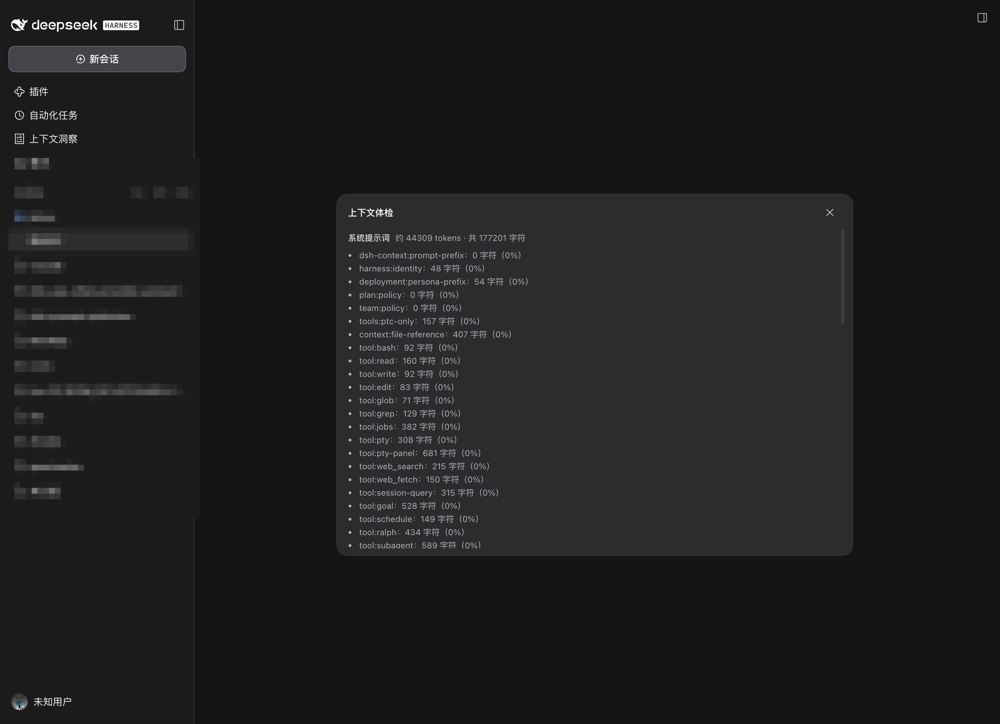
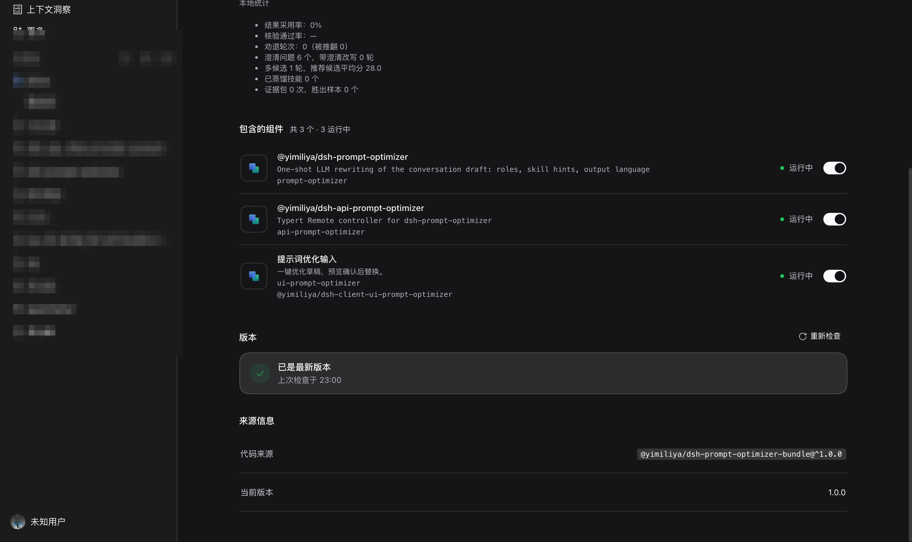

# dsh-prompt-optimizer

[English](README.md) · [简体中文](README_zh.md)

[](https://github.com/ViewWay/dsh-prompt-optimizer/actions/workflows/ci.yml)
[](https://www.npmjs.com/package/@yimiliya/dsh-prompt-optimizer-bundle)
[](https://github.com/ViewWay/dsh-prompt-optimizer)
[](https://dshfind.com/plugins/ViewWay/dsh-prompt-optimizer?ref=badge)

**把一段粗糙的想法草稿，打磨成可直接交给 Agent 执行的提示词的 DeepSeek Harness 插件**——多轮「重写 → 自评 → 修正」，每一轮的中间产物全部摊开供你审阅，而不是藏进黑盒。

独立分发的插件全家桶，一次安装为输入行增加六个入口和一个让优化全程可审计的预览面板：

| 入口 | 功能 |
| --- | --- |
| **优化** | 输入框一键改写草稿；领域推荐 chips 先帮你挑一个贴合的角色 |
| **先澄清后优化**（`?`） | 改写前先提出最多三个领域条件化的澄清问题，附可点选候选 |
| **验收先行** | 机械验收准则随行附带可执行的检查命令模板 |
| **多候选比选** | 一键生成 2–4 个差异化改写，一轮评审打分，帕累托标记 + 推荐位 |
| **上下文体检** | 零 LLM 调用的确定性扫描：会话系统提示词分段 + 可调用技能，可修复发现一键修复 |
| **提示词库** | 结果一键入库，之后随时浏览、插入草稿、再优化或删除 |



每一轮都可审阅，不是黑盒——预览面板把草稿与结果左右并排，附改动说明、验收标准和本轮命中的技能：

| 面板区块 | 是什么 | 怎么用来评判 |
| --- | --- | --- |
| 重写文本 | 优化后的提示词 | 与左栏草稿逐段对照阅读 |
| 改动点 | 模型自述的每处修改 | 逐条问：这处改动让任务更清楚了吗？有没有不该动的地方被改了？ |
| 验收标准 | 完成任务的判定条件 | 带命令的直接点「运行核验」机械验证；其余按判断点人工核——一条都不可验证即为质量可疑 |
| 技能 | 本轮匹配到的已安装技能 | 结果里提到技能时必须用列出的精确名称；没有列出时，结果不应凭空提任何技能 |
| 评审 | 系统提示词模式第二轮的修订记录 | 每条修订是否说清了改了什么、为什么改 |

快速检查清单：**细节零丢失**（路径、版本、命令、数字原样保留）· **结构分清**（目标、上下文、约束、期望输出分开陈述）· **无捏造** · **可验收** · **技能引用恰当**。任何一条不过关：点「换一版」（被拒绝的结果会作为前次尝试带入下一轮）、点方向 chips（更精简／更详尽／更技术／结构化／强化验收）、换角色重跑、或切「按系统提示词优化」模式。

## 安装 / 更新

### 在 DeepSeek Harness 网页版或桌面版中安装

在 **Add plugin** 向导的搜索框中填写 `@yimiliya/dsh-prompt-optimizer-bundle`，点击 **Install**。bundle 会把 `prompt-optimizer`、`api-prompt-optimizer`、`ui-prompt-optimizer` 三个条目一次叠加进该 profile。

### 使用 `dsh` CLI 安装

```sh
dsh plugin --profile web add @yimiliya/dsh-prompt-optimizer-bundle
```

或更新：

```sh
dsh plugin --profile web update @yimiliya/dsh-prompt-optimizer-bundle@latest
```

然后用 `dsh web` 启动 Web UI。无需构建，无需重启。

四个包尚未全部发布到 npm 前，请用 tarball 安装——直接写本地路径或 git 地址**不可用**：bundle 的 `workspace:*` 依赖只在本仓库的 pnpm workspace 内可解析，而 `dsh plugin add` 是在 profile 自己的安装根里装。打包会把版本范围改写为真实版本号，因此这条路需要另外三个包已发布：

```sh
pnpm -r pack        # 在各包目录生成 *.tgz
dsh plugin --profile web add packages/bundle/yimiliya-dsh-prompt-optimizer-bundle-<version>.tgz
```

## 你会得到什么

### 角色库 — 164 个角色，改写前先推荐

`<slug>.md` 角色文件随包分发，`rolesDir` 未配置时默认启用：按需列出角色、按草稿推荐、指定角色重跑，并在设置页设默认角色。**产出语言跟随 Agent 界面语言**——中文界面出中文提示词，English 界面出英文，代码标识符、路径与命令保持原样。

### 技能感知 — 命中的技能并入改写

草稿命中已安装技能时，技能名与简介并入元提示词，产出直接引用这些技能的提示词，并带防幻觉的精确命名约束。中英文草稿均可匹配：内置双语术语桥接让「页面／接口／部署」等中文词也能命中英文描述的技能，反之亦然。

### 模型分挡 + 克制优化

改写按解析路由的模型能力档位条件化：推理模型得到无脚手架、高信息密度的改写；LiteLLM/vLLM/Ollama 后的本地小模型得到全显式的不变量约束。而 `skipCheck` 让工具保持诚实——推理模型上一份简短清晰的通用草稿会被**坦率劝退**而非改写；任何显式重跑仍会真正派发。

### 多候选比选 — 一键触发、差异化候选、一轮评审



一键生成 2–4 个差异化候选改写——后序候选看得到先序兄弟候选、必须做出不同取舍——再由一轮 LLM 评审按忠实／完备／清晰三维度（0–10）打分。面板展示带总分、帕累托最优标记与评审推荐位的候选；点选候选即换入正常的替换／入库／角色进化流程。评审轮失败时降级为无分候选而非整轮失败。

### 意图澄清面试 — 先澄清，再改写



输入行 `?` 触发，改写前先提出最多三个领域条件化的澄清问题并附可点选候选。回答作为权威需求并入改写、且在后续重跑中保留——「无需澄清」时直接落入普通优化轮。

### 提示词库 — 重复提示词变成资产



优化结果一键入库；输入行「库」按钮打开管理面板——浏览、展开正文、插入草稿、以库条目再发起优化、两步确认删除（最新在前）。

### 上下文体检 — 常驻上下文的确定性审计



一键确定性扫描（零 LLM 调用）会话的常驻上下文：组装后的系统提示词各分段（逐段体量、占比、粗估 token），以及工作目录可见的全部可调用技能（深读正文、重复检测、按技能目录核对文件引用）。它找出超长段落、近似重复的段落或技能、以及指向已不存在文件的失效引用。输入行入口，报告卡渲染。

### 上下文修复 — 每条可修复发现都有修复入口（P5）

体检的每条可修复发现都有了修复入口：失效文件引用确定性剥除（附最近似现存文件建议）、重复技能经一轮模型合并入第一个定义（被并入方留下墓碑说明，双方原件均保 `.bak`）、重复系统提示段落给出可手动复制的合并建议。每次写盘都是 预览 → 确认 → 重扫。

### 技能进化 — 更新既有技能，而非重新蒸馏（P6a）

草稿形态一旦蒸馏过，下一次重复阈值会建议*更新该技能*而非重新蒸馏——一轮进化把新轮次的要求并入既有定义并原地覆盖（保留 `.bak`）。

### 采纳回流 — 后续轮次引用先例（P6b）

每次应用的结果被记为同域先例（每域最优 3 条，按 judge 分与新近排序），后续同域轮次引用其为参考——仅作参考绝不照抄；本地小模型档不注入；`precedents` 配置可整体关闭。

### 证据包 — 优化在这个路由上到底有没有用（P7）

内置领域交错的模糊样本集回答「优化在这个路由上到底有没有用」——体检面板内一键对每条样本跑 改写+judge 的 原始vs优化 对比；结果落入本地统计卡，模型切换过期提示也已指向重跑对比。

### 验收先行模式 — 锚定可观测的完成定义（P8）

专用触发运行 goal 面试，首问固定锚定可观测的完成定义；答案编译为权威 `goalCriteria`，改写必须满足并逐条重述，其余答案保持普通澄清。

### 技能蒸馏 — 同一草稿的第三次改写沉淀为技能

宿主为每个完成的轮次记录草稿指纹（归一化哈希，绝不存内容）；同一份草稿第三次优化时，面板主动建议把它蒸馏成持久技能。一轮模型生成 `SKILL.md`（frontmatter 名称/描述 + 渐进披露正文），确认后写入会话项目的 `.dsh/skills`（可配 `distillDir`），harness 技能注册表立即可见——重复的提示词从此变成可调用的持久资产，而不是又一次改写。

### 本地统计 + 模型切换提醒

每轮结局本地计数——采用率、核验通过率、劝退与推翻、面试问题数、候选平均分——并在设置页渲染；指标行只含路由与时间戳，绝不存草稿内容。每轮系统提示词优化记录所用路由（按会话、仅本地）；此后任何一轮解析到不同模型时，预览面板提示「系统提示词是为旧模型调的」并建议重新按系统提示词优化。全部元提示模板由字节级金标用例守护，模板无意改动过不了门禁。



## 配置（可选，cordis.yml 的 `plugins > config > prompt-optimizer`）

| 字段 | 默认 | 说明 |
| --- | --- | --- |
| `verifyTimeoutMs` | 见源码 | 验收检查命令的超时 |
| `domainPriors` | `true` | 按草稿的技术领域注入先验 |
| `provider` / `model` | 未设置 | 显式指定优化用的模型路由，两者必须成对出现 |
| `rolesDir` | 内置角色库 | 角色定义目录覆盖（`<slug>.md`）；未设置时使用随包分发的角色库（对「改进此角色」只读） |
| `defaultRole` | 未设置 | 未显式指定角色时使用的默认角色 slug；配置页也可设置 |
| `skillAware` | `true` | 把命中的已安装技能并入元提示词 |
| `skipCheck` | `true` | 允许「不优化」预检跳过它无法改进的轮次 |
| `metrics` | `true` | 本地记录结局指标（采用、核验、劝退、面试）供设置页展示 |
| `precedents` | `true` | 把被采纳的结果记为同域先例（与 metrics 不同，存内容）供后续轮次引用 |

## 隐私

优化过程会记录进会话自身的事件日志，请据此对待草稿内容：

- 每一轮优化都会向会话追加一条 `plugin:prompt-optimizer/llm-request` 记录，包含完整草稿文本与辅助 system prompt。
- 每次运行核验都会追加一条 `plugin:prompt-optimizer/verify` 记录，包含所执行的命令与其（已脱敏的）输出。
- 一次被劝退的轮次会追加一条 `plugin:prompt-optimizer/skipped` 记录，包含稳定的劝退原因与草稿字节数。
- 本地统计在独立存储域中每个结局存一行（类别、路由、档位、时间戳、计数）——绝不存草稿或结果正文。技能链接只存单向草稿指纹与技能名；重复指纹同样是单向哈希。
- 先例域是唯一的刻意例外：它存被采纳的完整优化文本（每域最优 3 条）供后续轮次引用——与草稿同机、同会话日志，绝不外发。`precedents: false` 可停止存储与注入。
- 确认过的上下文修复或技能进化会在重写的每个文件旁写入 `.bak` 备份，位于会话项目的技能目录。
- 「改进此角色」会重写所配置 `rolesDir` 下的角色定义文件 `<slug>.md`；旧版本保留在同目录的 `<slug>.md.bak`。内置默认角色库为只读：配置 `rolesDir` 后才能启用角色进化。

向草稿中粘贴密钥等敏感内容时，应预期它们出现在会话日志里。

## 仓库布局

| 包 | npm | 作用 |
| --- | --- | --- |
| `packages/prompt-optimizer` | [@yimiliya/dsh-prompt-optimizer](https://www.npmjs.com/package/@yimiliya/dsh-prompt-optimizer) | Host 服务：优化轮次、角色库、技能提示、模型路由 |
| `packages/api-prompt-optimizer` | [@yimiliya/dsh-api-prompt-optimizer](https://www.npmjs.com/package/@yimiliya/dsh-api-prompt-optimizer) | Remote 控制器与 Typert 描述符（host/client 共享方法表） |
| `packages/client-ui-prompt-optimizer` | [@yimiliya/dsh-client-ui-prompt-optimizer](https://www.npmjs.com/package/@yimiliya/dsh-client-ui-prompt-optimizer) | 浏览器 UI：触发按钮、预览面板、队列入口、设置页 |
| `packages/bundle` | [@yimiliya/dsh-prompt-optimizer-bundle](https://www.npmjs.com/package/@yimiliya/dsh-prompt-optimizer-bundle) | Profile bundle（`cordis.patch.yml`），一次安装叠加全部三个插件 |

每个包都带有自己的 README（会展示在其 npm 包页上）；本文档是全家桶视角。`tools/tsdown.client.ts` 是独立版客户端打包预设：按 harness 的 `window.__ModuleLoader__.load({id, factory})` 契约产出浏览器闭包工件，CSS Modules 经 lightningcss 编译为自带样式的注入模块。

## 开发

```sh
pnpm install
pnpm run check      # lint + 类型检查 + 构建 + 测试（与 CI 相同的门禁）
pnpm run typecheck  # 仅类型检查
pnpm run lint       # oxlint
pnpm run test       # vitest（node + client 两个 project）
pnpm run build      # tsdown，按依赖顺序
```

- **node project**（host + api 测试）开箱即跑。
- **client project**（jsdom 浏览器测试）需要一份 deepseek-harness 检出：已发布的 dsh 客户端包是浏览器闭包工件，只能在真实 Web 客户端里加载，测试改为按 harness `tsconfig.base.json` 的 paths 解析到其源码树——这也是这些用例在 harness 仓库内的原生跑法。默认取仓库同级目录 `../deepseek-harness-latest`，或用环境变量指定：

  ```sh
  DSH_HARNESS_ROOT=/path/to/deepseek-harness pnpm run test
  ```

  harness 检出内需已执行过 `pnpm install`（其源码依赖从自身树内解析）。测试配置同时把 react / react-dom / use-sync-external-store 收敛到单一实例，避免跨副本的 hook 报错。

代理与贡献者请先阅读 [AGENTS.md](AGENTS.md) 了解仓库约定。

## 兼容性

支持的基线为 `@deepseek-ai/dsh-*` `0.2.1-rc.5`；更早版本未验证。已发布的版本经由 `engines.dsh` 在整条 `0.2.x` 线上保持可用——细节（含队列入口的插槽要求与锁定的 peer 依赖）见 [docs/compatibility.md](docs/compatibility.md)，该文件是唯一事实来源。

## 发布（维护者）

四个包保持版本一致。打 tag（`git tag vX.Y.Z && git push origin vX.Y.Z`）后，GitHub Actions 会按依赖顺序（host → api → client → bundle）构建、检查并把四个包发布到 npm。见 `.github/workflows/release.yml`。

## 喜欢它？

如果 `dsh-prompt-optimizer` 让你的草稿更容易落地，欢迎在 [GitHub](https://github.com/ViewWay/dsh-prompt-optimizer) 点亮 ⭐——也欢迎提交 issue / PR！

## 许可证

[Apache-2.0](LICENSE)
